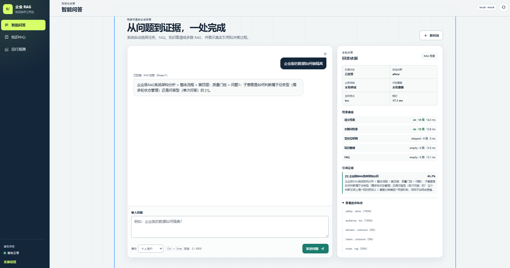
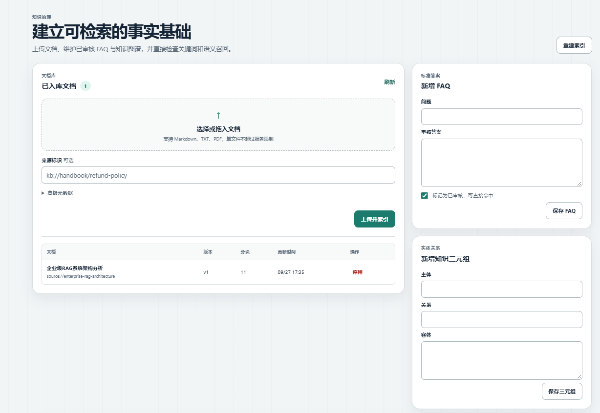
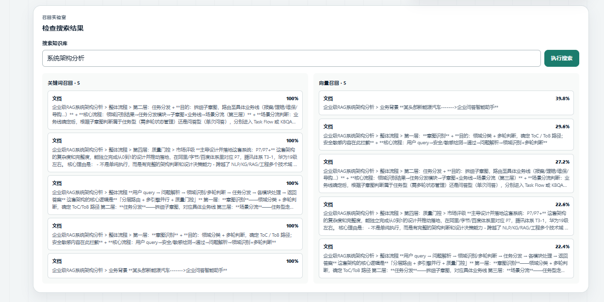
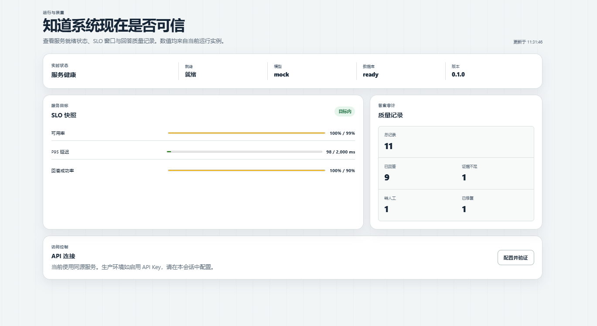

# Interactive Demo

This page documents the four UI states that best explain the Enterprise RAG Workbench. The screenshots are captured from the local workbench using the deterministic `mock` provider; no external API key is required.

## 1. Ask a question and inspect the evidence

The answer view combines the conversation, route decision, retrieval-channel status, latency, citations, and the complete decision trace. This is the main “question to evidence” workflow.



What to look for:

- The answer is associated with a source citation such as `[1]`.
- The right-hand panel shows the selected route and each retrieval channel.
- The trace makes the safety, audience, intent, and route decisions visible.

## 2. Ingest and govern knowledge

The knowledge center supports document upload, source URI metadata, re-indexing, document versioning, FAQ approval, and knowledge-graph triple management.



The recommended demo sequence is:

1. Upload a Markdown document.
2. Confirm the document version and chunk count.
3. Add an approved FAQ or a knowledge-graph triple.
4. Rebuild indexes.
5. Return to the answer view and verify the citation.

## 3. Compare lexical and semantic retrieval

The search view exposes keyword and vector candidates side by side. This is useful for explaining why hybrid retrieval is more robust than relying on one index.



Use this screen to inspect:

- Candidate count and score per retrieval mode.
- Differences between exact keyword matches and semantic matches.
- Whether multiple chunks from one source are crowding out diverse evidence.

## 4. Inspect service health and answer quality

The observability view reports readiness, model provider, database state, SLO indicators, and persisted answer-quality outcomes.



The displayed quality summary separates successful answers, evidence-insufficient refusals, human handoffs, and repaired answers. This makes the system’s safety behavior measurable instead of hiding refusals as generic errors.

## Reproduce the demo locally

```powershell
uv sync
Copy-Item .env.example .env
uv run uvicorn enterprise_rag.main:app --host 127.0.0.1 --port 8000
```

Open <http://127.0.0.1:8000/> and use the navigation items for 智能问答, 知识中心, and 运行观测. The API and acceptance commands are documented in the [README](../README.md) and [operations guide](OPERATIONS.md).

## Demo boundaries

These screenshots demonstrate the local reference workflow, not a production deployment. The default mock model is deterministic; production use still requires real model credentials, tenant-level authorization, persistent storage, monitoring, and an operational review of data retention and access control.
